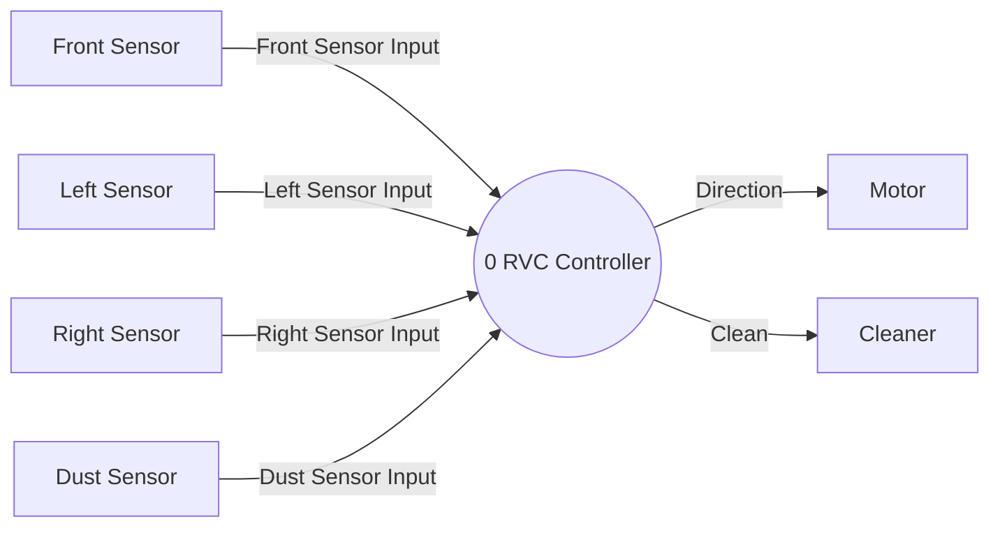

# DFD Level 0

Process 0 is the whole RVC Controller. Its external flows are the same flows as the System Context Diagram.

## Processes

| Process ID | Process Name | Kind |
|---|---|---|
| 0 | RVC Controller | Data process representing the whole system |

## Balancing with the Context Diagram

| Flow | Context | Level 0 |
|---|---|---|
| Front Sensor Input | Front Sensor → RVC Controller | Front Sensor → Process 0 |
| Left Sensor Input | Left Sensor → RVC Controller | Left Sensor → Process 0 |
| Right Sensor Input | Right Sensor → RVC Controller | Right Sensor → Process 0 |
| Dust Sensor Input | Dust Sensor → RVC Controller | Dust Sensor → Process 0 |
| Direction | RVC Controller → Motor | Process 0 → Motor |
| Clean | RVC Controller → Cleaner | Process 0 → Cleaner |

Tick remains inside Process 0 at this level.
