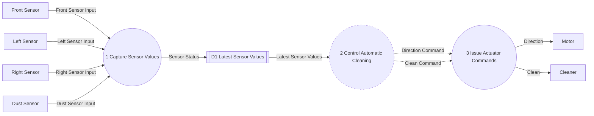

# DFD Level 1

Process 0 is decomposed into sensor capture, cleaning control, and actuator output. Process 2 is the control process. A dashed circle marks a control process.

## Processes and stores

| ID | Name | Kind |
|---|---|---|
| 1 | Capture Sensor Values | Data process |
| 2 | Control Automatic Cleaning | Control process |
| 3 | Issue Actuator Commands | Data process |
| D1 | Latest Sensor Values | Data store |

## Balancing with Level 0

| Level 0 flow | Level 1 preservation |
|---|---|
| Front Sensor Input | Front Sensor → Process 1 |
| Left Sensor Input | Left Sensor → Process 1 |
| Right Sensor Input | Right Sensor → Process 1 |
| Dust Sensor Input | Dust Sensor → Process 1 |
| Direction | Process 3 → Motor |
| Clean | Process 3 → Cleaner |

Internal flows added at Level 1:

| Flow | Category | Path |
|---|---|---|
| Sensor Status | Data | Process 1 → D1 |
| Latest Sensor Values | Data | D1 → Process 2 |
| Direction Command | Control | Process 2 → Process 3 |
| Clean Command | Control | Process 2 → Process 3 |

Tick is still inside Process 2. It becomes visible when Process 2 is decomposed.
