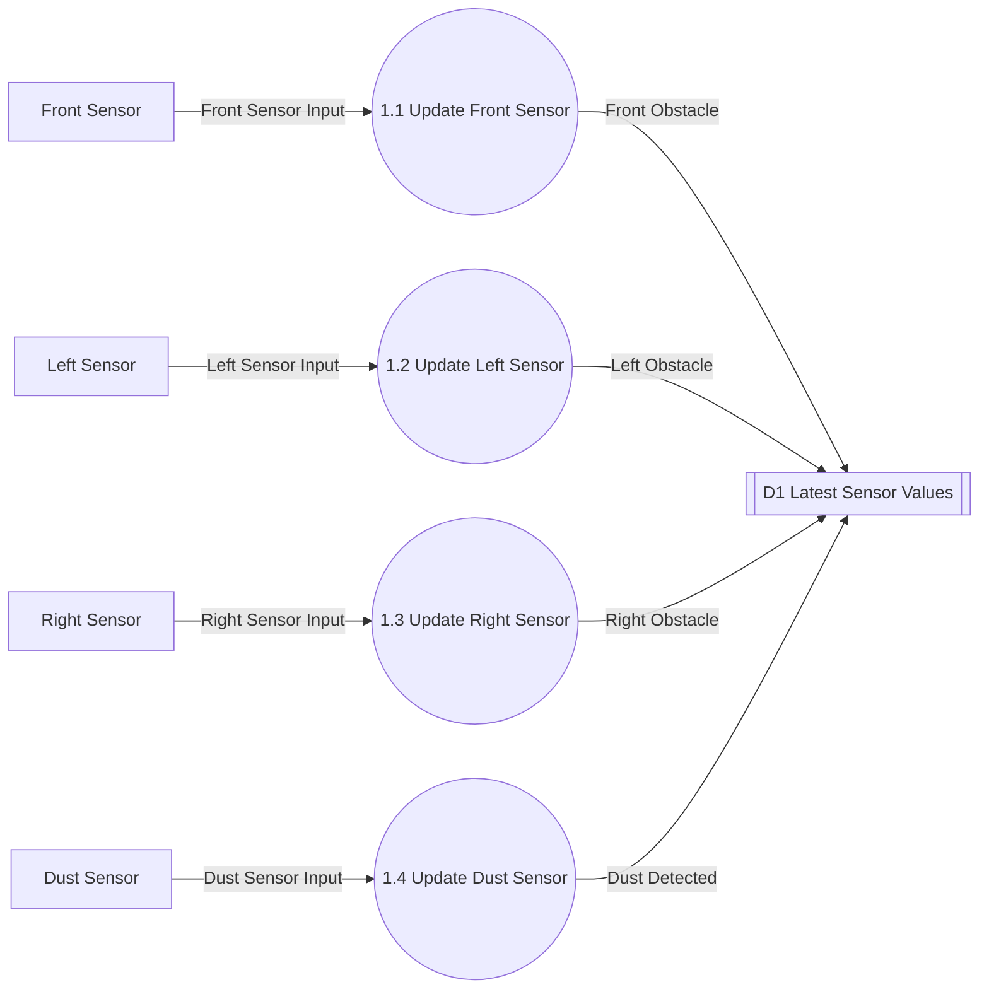
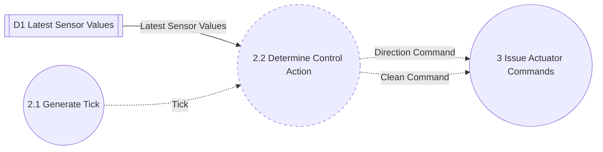
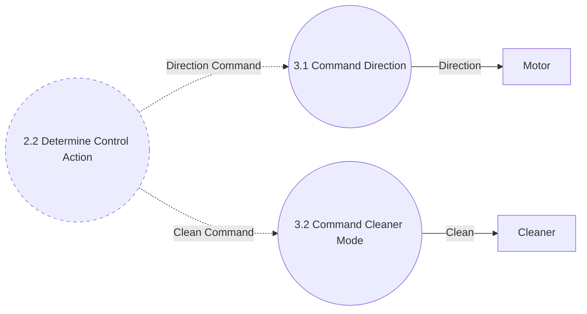

# DFD Level 2

Level 2 uses one diagram for each Level 1 process. Interface processes are shown only so parent inputs and outputs stay visible. They are not children of the process being decomposed.

## Flow mapping from Level 1

| Level 1 flow | Level 2 mapping |
|---|---|
| Sensor Status | Front Obstacle + Left Obstacle + Right Obstacle + Dust Detected, written to D1 |
| Latest Sensor Values | The same four stored values, read from D1 by Process 2.2 |
| Direction Command | Process 2.2 → Process 3.1 |
| Clean Command | Process 2.2 → Process 3.2 |
| Direction | Process 3.1 → Motor |
| Clean | Process 3.2 → Cleaner |
| Tick | New internal control flow, Process 2.1 → Process 2.2. It was hidden inside Process 2 at Level 1. |

## Diagram 2.1 — Process 1 Capture Sensor Values

| Process ID | Process Name | Kind |
|---|---|---|
| 1.1 | Update Front Sensor | Data process |
| 1.2 | Update Left Sensor | Data process |
| 1.3 | Update Right Sensor | Data process |
| 1.4 | Update Dust Sensor | Data process |

Parent inputs preserved: Front Sensor Input, Left Sensor Input, Right Sensor Input, Dust Sensor Input.

Parent output preserved: Sensor Status, decomposed into the four stored values.

## Diagram 2.2 — Process 2 Control Automatic Cleaning

Process 3 is the destination of the parent outputs. It is not a child of Process 2.

| Process ID | Process Name | Kind |
|---|---|---|
| 2.1 | Generate Tick | Data process that emits the internal Tick control flow |
| 2.2 | Determine Control Action | Control process |

Parent input preserved: Latest Sensor Values.

Parent outputs preserved: Direction Command and Clean Command.

Tick is internal to parent Process 2.

## Diagram 2.3 — Process 3 Issue Actuator Commands

Process 2.2 is the source of the parent inputs. It is not a child of Process 3.

| Process ID | Process Name | Kind |
|---|---|---|
| 3.1 | Command Direction | Data process |
| 3.2 | Command Cleaner Mode | Data process |

Parent inputs preserved: Direction Command, Clean Command.

Parent outputs preserved: Direction, Clean.
