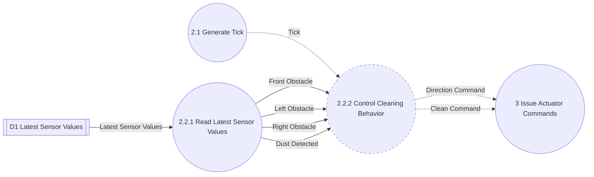

# DFD Level 3

Process 2.2 is the only Level 2 process that still needs separation between data access and control. Processes 1.1–1.4, 2.1, 3.1, and 3.2 already have a single responsibility and are not decomposed further.

Process 2.2.2 is the Controller. Its behavior is specified as the Level 4 FSM.

## Flow mapping from Level 2 Process 2.2

| Level 2 flow | Level 3 mapping |
|---|---|
| Latest Sensor Values | D1 → Process 2.2.1, then split into Front Obstacle, Left Obstacle, Right Obstacle, and Dust Detected |
| Tick | Process 2.1 → Process 2.2.2 |
| Direction Command | Process 2.2.2 → Process 3 |
| Clean Command | Process 2.2.2 → Process 3 |

Process 2.1 and Process 3 appear as interface processes. They are not children of Process 2.2.

## Processes

| Process ID | Process Name | Kind |
|---|---|---|
| 2.2.1 | Read Latest Sensor Values | Data process |
| 2.2.2 | Control Cleaning Behavior | Control process. Controller represented by the Level 4 FSM. |

## Balancing with Process 2.2

| Parent interface | Child interface |
|---|---|
| Input: Latest Sensor Values from D1 | D1 → Process 2.2.1 |
| Input: Tick from Process 2.1 | Process 2.1 → Process 2.2.2 |
| Output: Direction Command | Process 2.2.2 → Process 3 |
| Output: Clean Command | Process 2.2.2 → Process 3 |

The four flows from Process 2.2.1 to Process 2.2.2 are the contents of Latest Sensor Values. They do not add an external input.
