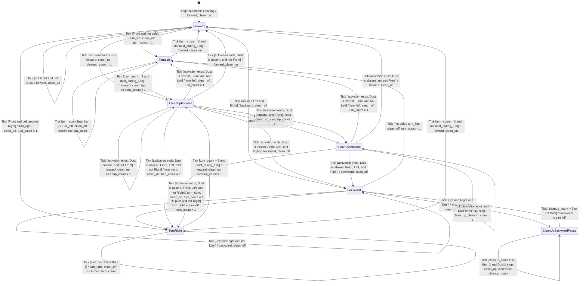

# DFD Level 4 — Controller FSM

Process 2.2.2 Control Cleaning Behavior is the Controller. This FSM is that process. There is no separate process specification for Level 4.

## Controller interface

| Direction | Name | Category |
|---|---|---|
| Input data | Front Obstacle | Boolean. True means a front obstacle is detected. |
| Input data | Left Obstacle | Boolean. True means the left side is blocked. |
| Input data | Right Obstacle | Boolean. True means the right side is blocked. |
| Input data | Dust Detected | Boolean. True means dust is detected. |
| Input control | Tick | Internal temporal event. |
| Output control | Direction Command | forward, backward, turn_left, turn_right, or stop. |
| Output control | Clean Command | clean_off, clean_on, or clean_up. |

## Internal controller state

These values stay inside Process 2.2.2. They are not DFD flows.

| Name | Meaning |
|---|---|
| turn_count | Number of turn-command ticks already issued in the current turn. A turn is complete when this value is 3. |
| cleanup_count | Number of clean_up-command ticks already issued in the current activation. An activation is complete when this value is 3. |
| dust_during_turn | True when Dust Detected has been true on any tick evaluated in the current turn state, including the tick that starts the turn and the tick that completes it. |

## Counting rule

A transition that starts a turn or a clean_up activation sets the corresponding count to 1 and issues the turn or clean_up command on that same tick. That tick is tick 1.

On later ticks in that state, while the count is less than 3, the controller increments the count and issues the same command again.

The tick on which the count is already 3 does not issue another tick of that turn or that activation. Three command ticks have already occurred.

A clean_up activation also ends on a tick where Dust Detected is false, even when the count is less than 3.

## States

| State | Direction Command while the state continues | Clean Command while the state continues |
|---|---|---|
| Forward | forward | clean_on |
| CleanUpForward | forward | clean_up |
| CleanUpStopped | stop | clean_up |
| TurnLeft | turn_left | clean_off |
| TurnRight | turn_right | clean_off |
| Backward | backward | clean_off |
| CleanUpBackwardPause | stop | clean_up |

The initial state is Forward. Automatic cleaning begins with Direction Command = forward and Clean Command = clean_on. The requirements do not name a separate power-on event.

clean_off is issued only in TurnLeft, TurnRight, and Backward.

## State diagram

`activation continues` means cleanup_count is less than 3 and Dust Detected is true.

`activation ends` means cleanup_count is 3 or Dust Detected is false.

On every tick evaluated in TurnLeft or TurnRight, if Dust Detected is true, dust_during_turn is set true before the transition is selected. dust_during_turn is cleared when the turn state is left.

## Transition table

| Current State | Event | Condition | Action | Next State |
|---|---|---|---|---|
| — | begin automatic cleaning | Automatic cleaning starts | Direction = forward, Clean = clean_on | Forward |
| Forward | Tick | Front and not Left | turn_count = 1, dust_during_turn = Dust, Direction = turn_left, Clean = clean_off | TurnLeft |
| Forward | Tick | Front and Left and not Right | turn_count = 1, dust_during_turn = Dust, Direction = turn_right, Clean = clean_off | TurnRight |
| Forward | Tick | Front and Left and Right | Direction = backward, Clean = clean_off | Backward |
| Forward | Tick | not Front and Dust | cleanup_count = 1, Direction = forward, Clean = clean_up | CleanUpForward |
| Forward | Tick | not Front and not Dust | Direction = forward, Clean = clean_on | Forward |
| TurnLeft | Tick | turn_count < 3 | If Dust, dust_during_turn = true. turn_count = turn_count + 1. Direction = turn_left. Clean = clean_off | TurnLeft |
| TurnLeft | Tick | turn_count = 3 and dust_during_turn after applying this tick's Dust | cleanup_count = 1, dust_during_turn = false, Direction = forward, Clean = clean_up | CleanUpForward |
| TurnLeft | Tick | turn_count = 3 and dust_during_turn is false after applying this tick's Dust | dust_during_turn = false, Direction = forward, Clean = clean_on | Forward |
| TurnRight | Tick | turn_count < 3 | If Dust, dust_during_turn = true. turn_count = turn_count + 1. Direction = turn_right. Clean = clean_off | TurnRight |
| TurnRight | Tick | turn_count = 3 and dust_during_turn after applying this tick's Dust | cleanup_count = 1, dust_during_turn = false, Direction = forward, Clean = clean_up | CleanUpForward |
| TurnRight | Tick | turn_count = 3 and dust_during_turn is false after applying this tick's Dust | dust_during_turn = false, Direction = forward, Clean = clean_on | Forward |
| Backward | Tick | not Left | turn_count = 1, dust_during_turn = Dust, Direction = turn_left, Clean = clean_off | TurnLeft |
| Backward | Tick | Left and not Right | turn_count = 1, dust_during_turn = Dust, Direction = turn_right, Clean = clean_off | TurnRight |
| Backward | Tick | Left and Right and Dust | cleanup_count = 1, Direction = stop, Clean = clean_up | CleanUpBackwardPause |
| Backward | Tick | Left and Right and not Dust | Direction = backward, Clean = clean_off | Backward |
| CleanUpBackwardPause | Tick | cleanup_count < 3 and Dust | cleanup_count = cleanup_count + 1, Direction = stop, Clean = clean_up | CleanUpBackwardPause |
| CleanUpBackwardPause | Tick | cleanup_count = 3 or not Dust | Direction = backward, Clean = clean_off | Backward |
| CleanUpForward | Tick | cleanup_count < 3 and Dust and Front | cleanup_count = cleanup_count + 1, Direction = stop, Clean = clean_up | CleanUpStopped |
| CleanUpForward | Tick | cleanup_count < 3 and Dust and not Front | cleanup_count = cleanup_count + 1, Direction = forward, Clean = clean_up | CleanUpForward |
| CleanUpForward | Tick | (cleanup_count = 3 or not Dust) and Dust and Front | cleanup_count = 1, Direction = stop, Clean = clean_up | CleanUpStopped |
| CleanUpForward | Tick | (cleanup_count = 3 or not Dust) and Dust and not Front | cleanup_count = 1, Direction = forward, Clean = clean_up | CleanUpForward |
| CleanUpForward | Tick | (cleanup_count = 3 or not Dust) and not Dust and Front and not Left | turn_count = 1, dust_during_turn = false, Direction = turn_left, Clean = clean_off | TurnLeft |
| CleanUpForward | Tick | (cleanup_count = 3 or not Dust) and not Dust and Front and Left and not Right | turn_count = 1, dust_during_turn = false, Direction = turn_right, Clean = clean_off | TurnRight |
| CleanUpForward | Tick | (cleanup_count = 3 or not Dust) and not Dust and Front and Left and Right | Direction = backward, Clean = clean_off | Backward |
| CleanUpForward | Tick | (cleanup_count = 3 or not Dust) and not Dust and not Front | Direction = forward, Clean = clean_on | Forward |
| CleanUpStopped | Tick | cleanup_count < 3 and Dust | cleanup_count = cleanup_count + 1, Direction = stop, Clean = clean_up | CleanUpStopped |
| CleanUpStopped | Tick | (cleanup_count = 3 or not Dust) and Dust | cleanup_count = 1, Direction = stop, Clean = clean_up | CleanUpStopped |
| CleanUpStopped | Tick | (cleanup_count = 3 or not Dust) and not Dust and Front and not Left | turn_count = 1, dust_during_turn = false, Direction = turn_left, Clean = clean_off | TurnLeft |
| CleanUpStopped | Tick | (cleanup_count = 3 or not Dust) and not Dust and Front and Left and not Right | turn_count = 1, dust_during_turn = false, Direction = turn_right, Clean = clean_off | TurnRight |
| CleanUpStopped | Tick | (cleanup_count = 3 or not Dust) and not Dust and Front and Left and Right | Direction = backward, Clean = clean_off | Backward |
| CleanUpStopped | Tick | (cleanup_count = 3 or not Dust) and not Dust and not Front | Direction = forward, Clean = clean_on | Forward |

Within one state, the conditions are mutually exclusive. The first matching row for that state is the selected transition. Front obstacle handling in Forward comes before dust handling. In Backward, a clear side comes before dust handling.

## Requirement coverage

| Requirement | FSM behavior |
|---|---|
| Go forward while cleaning | Forward issues forward and clean_on. |
| Front obstacle: stop cleaning, turn left or right, then go forward | Forward chooses TurnLeft or TurnRight. The turn uses clean_off. After 3 turn ticks the controller enters Forward or CleanUpForward. |
| Front, left, and right all blocked | Forward enters Backward. |
| Left turn has priority | TurnLeft is selected whenever the left side is clear and a turn is required. |
| Turn lasts 3 ticks | turn_count reaches 3 before the turn state is left. The leaving tick does not add a fourth turn command. |
| Dust powers up cleaning | Forward with dust and no front obstacle enters CleanUpForward. |
| One clean_up activation lasts at most 3 ticks and ends sooner when dust is absent | cleanup_count and the Dust condition end the activation. |
| clean_off only while backing up or turning | clean_off is produced only in TurnLeft, TurnRight, and Backward. Stop uses clean_up. |
| Direction can stop the RVC | CleanUpStopped and CleanUpBackwardPause issue stop. |
| Backward continues until the left or right side is clear, then turns, with left priority | Backward leaves to TurnLeft or TurnRight when a side is clear. |
| Front obstacle during clean_up: stop, keep cleaning, and do not turn or back up until that cleaning ends | CleanUpForward moves to CleanUpStopped. CleanUpStopped turns or backs up only after Dust is false. If dust remains when an activation ends, the next activation starts while stopped. |
| Dust while moving backward: stop, one clean_up activation, then backward again | Backward enters CleanUpBackwardPause. That pause returns to Backward after one activation, including when dust is still true at the 3-tick limit. |
| Dust during a turn: finish the turn, then go forward in clean_up | A turn is not interrupted. dust_during_turn selects CleanUpForward when the turn completes. |

## Reachability

| State | How it is reached |
|---|---|
| Forward | Initial state. Also from a completed turn without dust, from the end of clean_up when dust is absent and the front is clear. |
| TurnLeft | Forward, Backward, CleanUpForward, or CleanUpStopped when a left turn is the selected avoidance. |
| TurnRight | The same sources when the left side is blocked and the right side is clear. |
| Backward | Forward, CleanUpForward, or CleanUpStopped when the front, left, and right are blocked. Also the end of CleanUpBackwardPause. |
| CleanUpForward | Forward when dust is present and the front is clear. Also the end of a turn in which dust was detected. |
| CleanUpStopped | CleanUpForward when the front is blocked while dust cleaning continues. |
| CleanUpBackwardPause | Backward when both sides are blocked and dust is detected. |

Every state has an outgoing Tick transition. No state is terminal.

## Recorded interpretations

The following points are not fully explicit in the preliminary requirements. The FSM uses one interpretation so the artifacts stay consistent. These points remain open for confirmation before implementation.

1. Boolean true means detected. Boolean false means not detected.
2. Until the first sample of a sensor arrives, the stored value is false.
3. The controller decides once per Tick from the latest stored values. A front interrupt updates the stored value. It does not by itself end a turn or a clean_up activation.
4. No separate start event is specified. Automatic cleaning starts in Forward with clean_on.
5. In Forward, a front obstacle is handled before dust. The special stop-and-keep-cleaning rule applies only after clean_up has started.
6. A side obstacle does not by itself start a turn while the front is clear. Left and right values choose the turn direction and decide when backward movement can end.
7. After a turn completes, the next command is forward. If the front is still blocked, the following Forward tick applies obstacle avoidance again.
8. Dust on any tick of a turn state, including the completion tick, causes the following motion to be forward in clean_up even if dust is false at the moment the turn completes.
9. In Backward, a clear side is handled before dust. Dust during the resulting turn is handled by the turn rule.
10. The backward dust response is exactly one clean_up activation. If dust is still true after that activation, the controller returns to Backward. A later Backward tick can start another single activation.
11. A front obstacle during an ongoing clean_up activation continues that same activation while stopped. The count is not reset. A new activation starts only when the current one ends and dust remains.
12. CleanUpStopped continues until dust is false, including when the front obstacle clears during the stop. After dust is false, the latest front, left, and right values select forward, turn, or backward.
13. The literal command names and any numeric encoding of Direction and Clean are not specified.
14. Tick length and the periods of the left, right, and dust sensors are not specified.
15. Cleaning and mopping are both described, and only the cleaner mode is specified. There is no separate mop output.
16. Hardware motor and cleaner control is out of scope. Direction and Clean are the controller outputs.
