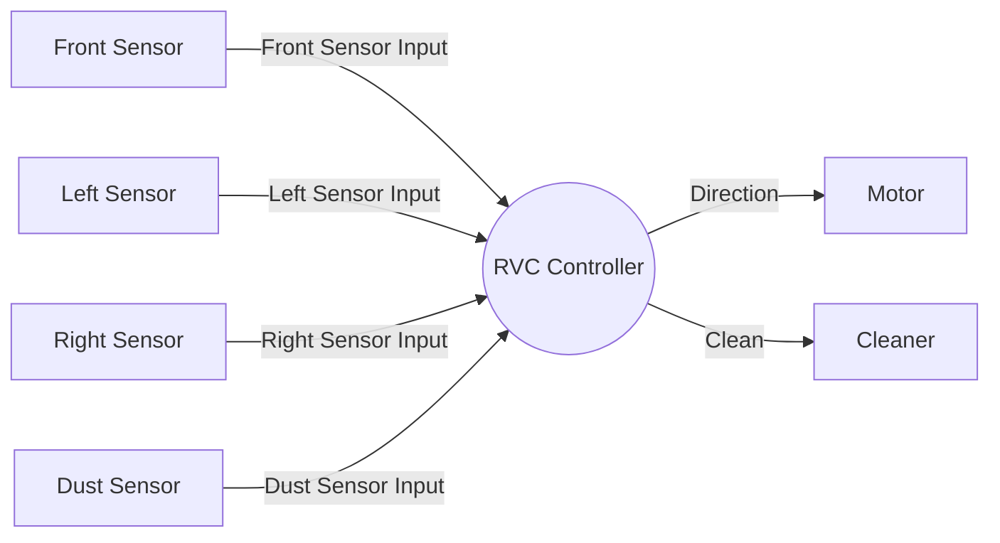

# System Context Diagram

The system is the RVC software controller for automatic cleaning. Hardware control details are outside the system. The context shows only the external sensor inputs and the two actuator commands.

Tick is listed in the Event List as an internal temporal event. It is produced inside the controller and is not drawn here.

## Context elements

| Element | Role |
|---|---|
| Front Sensor | External source of Front Sensor Input. Arrival is interrupt-driven. |
| Left Sensor | External source of Left Sensor Input. Arrival is periodic. |
| Right Sensor | External source of Right Sensor Input. Arrival is periodic. |
| Dust Sensor | External source of Dust Sensor Input. Arrival is periodic. |
| RVC Controller | The single system process. |
| Motor | External destination of Direction. |
| Cleaner | External destination of Clean. |

## Consistency with the Event List

| Event List entry | Context arrow |
|---|---|
| Front Sensor Input | Front Sensor → RVC Controller |
| Left Sensor Input | Left Sensor → RVC Controller |
| Right Sensor Input | Right Sensor → RVC Controller |
| Dust Sensor Input | Dust Sensor → RVC Controller |
| Direction | RVC Controller → Motor |
| Clean | RVC Controller → Cleaner |
| Tick | No context arrow. Tick is internal. |
