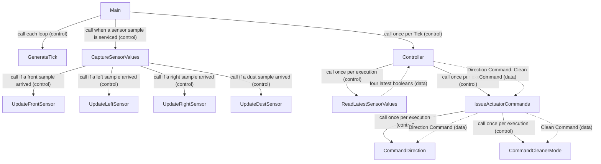

# Structure Chart

## 1. Objective
Define the C call hierarchy for the RVC automatic-cleaning controller. `Main` is the program root. `Controller` is the module that executes the Level 4 FSM. Module calls are invocation relationships. They are not copies of the DFD arrows.

No library module is introduced. The requirements do not call for a separate reusable utility.

## 2. Notation

| Element | Use in this chart |
|---|---|
| Module | Rectangle |
| Module call | Solid arrow from caller to callee |
| Data passed along a call | Dotted arrow labeled `(data)` |
| Control that governs a call | Text `(control)` on the call label |
| Conditional call | Call label states the arrival condition |
| Repeated call | Call label states `each tick` or `each servicing` |

Mermaid flowchart has one non-solid arrow form. Labels therefore say `(data)` or `(control)` explicitly.

## 3. Module Hierarchy

`Main` repeats two kinds of work. When a sensor sample is being serviced, it calls `CaptureSensorValues`. When a tick has occurred, it calls `Controller` once. `Controller` reads the hidden sensor store, updates its own FSM state, and calls `IssueActuatorCommands`.

Execution order on a tick:

1. `Main` calls `GenerateTick`.
2. Sensor samples that have arrived are applied through `CaptureSensorValues` before the decision reads them. A sample that arrives after the read is kept for a later tick.
3. `Main` calls `Controller` once.
4. `Controller` calls `ReadLatestSensorValues`.
5. `Controller` evaluates one FSM transition and keeps the resulting state, counters, and dust-during-turn flag inside itself.
6. `Controller` calls `IssueActuatorCommands`.
7. `IssueActuatorCommands` calls `CommandDirection` and then `CommandCleanerMode`.

`UpdateFrontSensor` is conditional on interrupt arrival. The other three update calls are conditional on periodic arrival. `Controller` does not poll the raw sensors and does not call the update modules.

## 4. Module Descriptions

| Module | Responsibility | Called Modules |
|---|---|---|
| Main | Start automatic cleaning and coordinate tick generation, sensor servicing, and one controller execution per tick. This is the C `main` function. | GenerateTick, CaptureSensorValues, Controller |
| GenerateTick | Produce one internal Tick. The interval is TBD. | None |
| CaptureSensorValues | Service arrived sensor samples by calling only the update modules whose new samples are available. | UpdateFrontSensor, UpdateLeftSensor, UpdateRightSensor, UpdateDustSensor |
| UpdateFrontSensor | Replace the stored front value with the new interrupt sample. | None |
| UpdateLeftSensor | Replace the stored left value with the new periodic sample. | None |
| UpdateRightSensor | Replace the stored right value with the new periodic sample. | None |
| UpdateDustSensor | Replace the stored dust value with the new periodic sample. | None |
| ReadLatestSensorValues | Return the four stored booleans without changing them. | None |
| Controller | Hide the FSM state and execute one transition of Process 2.2.2 per tick. | ReadLatestSensorValues, IssueActuatorCommands |
| IssueActuatorCommands | Deliver both selected commands. It does not choose a new command. | CommandDirection, CommandCleanerMode |
| CommandDirection | Send Direction to the motor as the received Direction Command. | None |
| CommandCleanerMode | Send Clean to the cleaner as the received Clean Command. | None |

The stored sensor values are hidden. Only `UpdateFrontSensor`, `UpdateLeftSensor`, `UpdateRightSensor`, `UpdateDustSensor`, and `ReadLatestSensorValues` access that store. FSM state, `turn_count`, `cleanup_count`, and `dust_during_turn` are hidden inside `Controller`.

## 5. Module Interfaces

| Caller | Callee | Input Data | Output Data | Control Information |
|---|---|---|---|---|
| Main | GenerateTick | None | None | Repeated. Each completed call means one Tick has occurred. |
| Main | CaptureSensorValues | None | None | Called to service arrived sensor input. |
| CaptureSensorValues | UpdateFrontSensor | Front Sensor Input | None | Conditional on a new front interrupt sample. |
| CaptureSensorValues | UpdateLeftSensor | Left Sensor Input | None | Conditional on a new periodic left sample. |
| CaptureSensorValues | UpdateRightSensor | Right Sensor Input | None | Conditional on a new periodic right sample. |
| CaptureSensorValues | UpdateDustSensor | Dust Sensor Input | None | Conditional on a new periodic dust sample. |
| Main | Controller | None | None | Repeated once per Tick. |
| Controller | ReadLatestSensorValues | None | Front Obstacle, Left Obstacle, Right Obstacle, Dust Detected | Called once on every controller execution. |
| Controller | IssueActuatorCommands | Direction Command, Clean Command | None | Called once on every controller execution, after the transition. |
| IssueActuatorCommands | CommandDirection | Direction Command | Direction is sent to the motor | Called once per issue. |
| IssueActuatorCommands | CommandCleanerMode | Clean Command | Clean is sent to the cleaner | Called once per issue, after CommandDirection. |

`Controller` passes no sensor values to `Main`. `Main` passes no FSM state to the actuator modules.

## 6. SA-to-SD Traceability

| SA Process ID | SA Process Name | SD Module | Design Rationale |
|---|---|---|---|
| 0 | RVC Controller | Main, with the modules it coordinates | The system process is the program, not one lower-level function. |
| 1 | Capture Sensor Values | CaptureSensorValues | One module owns servicing of arrived samples. |
| 1.1 | Update Front Sensor | UpdateFrontSensor | Interrupt arrival stays separate from periodic arrival. |
| 1.2 | Update Left Sensor | UpdateLeftSensor | Periodic left samples update only the left value. |
| 1.3 | Update Right Sensor | UpdateRightSensor | Periodic right samples update only the right value. |
| 1.4 | Update Dust Sensor | UpdateDustSensor | Periodic dust samples update only the dust value. |
| 2 | Control Automatic Cleaning | Main's tick cycle, GenerateTick, and Controller | The parent control process is the repeated tick execution. A pass-through wrapper would repeat Main. |
| 2.1 | Generate Tick | GenerateTick | Tick production is separate from the decision. |
| 2.2 | Determine Control Action | Controller and ReadLatestSensorValues | The parent decision is split into a read and the FSM, matching Level 3. |
| 2.2.1 | Read Latest Sensor Values | ReadLatestSensorValues | Data access stays out of the FSM module. |
| 2.2.2 | Control Cleaning Behavior | Controller | The module hides the FSM and matches its inputs and outputs. |
| 3 | Issue Actuator Commands | IssueActuatorCommands | Output delivery stays out of the FSM. |
| 3.1 | Command Direction | CommandDirection | Movement output has its own module. |
| 3.2 | Command Cleaner Mode | CommandCleanerMode | Cleaner output has its own module. |
| D1 | Latest Sensor Values | Hidden store behind the five sensor modules | The store is not a called module. |

## 8. Design Validation

- Every SA process in Levels 1 through 3 maps to at least one module in the traceability table. Process 0 maps to the program rooted at `Main`.
- Every module has one responsibility: scheduling, tick production, sample servicing, one sensor update, sensor reading, FSM control, command issuing, or one actuator output.
- Solid arrows are calls. Dotted arrows are data returned to a caller or passed into a callee. Control is stated in the call labels and the interface table.
- `Controller` calls `ReadLatestSensorValues` before `IssueActuatorCommands`. Both calls happen on every tick, which matches an FSM that reads the latest values and emits both commands on every tick.
- Conditional calls are limited to the four sensor updates. Their conditions are the arrival rules from the requirements: front by interrupt, and left, right, and dust periodically.
- The FSM state is not shared with sensor or actuator modules.
- Sensor modules do not call `Controller` or the actuator modules.
- Actuator modules do not read sensors or change Direction Command and Clean Command.
- No module adds mop control, speed, turn angle, or hardware-register behavior.
- The open interpretations listed in the Level 4 FSM remain open. They are not resolved by extra modules.

TDD and C implementation are outside this structure chart.
