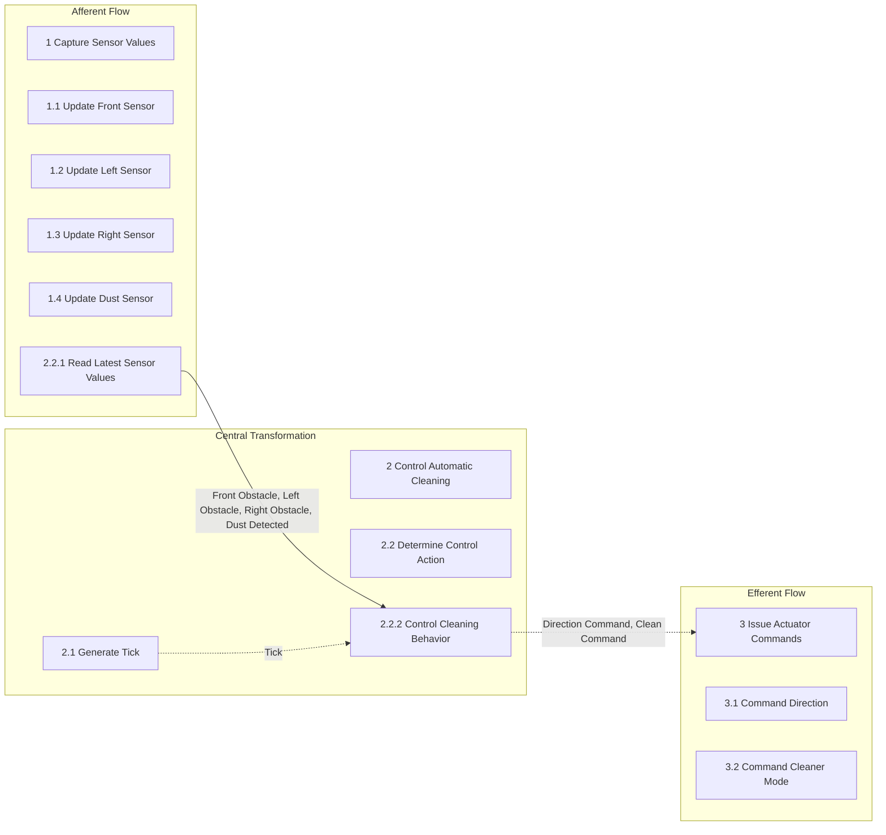

# Transform Analysis

## 1. Objective
Identify the Afferent Flow, Central Transformation, and Efferent Flow of the RVC controller from DFD Levels 1 through 3 and the Level 4 Controller FSM.

The transform is the tick-based cleaning decision. Sensor arrival only prepares the latest boolean values. Actuator processes only deliver the commands that the controller has already selected.

## 2. Transform Regions

### Afferent Flow (Input)

These processes receive sensor samples and make the latest values available to the controller.

| Process ID | Process Name | Input | Output |
|---|---|---|---|
| 1 | Capture Sensor Values | Front Sensor Input, Left Sensor Input, Right Sensor Input, Dust Sensor Input | Sensor Status |
| 1.1 | Update Front Sensor | Front Sensor Input | Front Obstacle |
| 1.2 | Update Left Sensor | Left Sensor Input | Left Obstacle |
| 1.3 | Update Right Sensor | Right Sensor Input | Right Obstacle |
| 1.4 | Update Dust Sensor | Dust Sensor Input | Dust Detected |
| 2.2.1 | Read Latest Sensor Values | Latest Sensor Values | Front Obstacle, Left Obstacle, Right Obstacle, Dust Detected |

Process 2.2.1 is afferent because it only reads stored input. It does not decide motion or cleaner mode.

### Central Transformation (Process)

These processes produce the internal tick and decide both commands.

| Process ID | Process Name | Input | Output |
|---|---|---|---|
| 2 | Control Automatic Cleaning | Latest Sensor Values | Direction Command, Clean Command |
| 2.1 | Generate Tick | None | Tick |
| 2.2 | Determine Control Action | Latest Sensor Values, Tick | Direction Command, Clean Command |
| 2.2.2 | Control Cleaning Behavior | Tick, Front Obstacle, Left Obstacle, Right Obstacle, Dust Detected | Direction Command, Clean Command |

Process 2.1 belongs to the central region because Tick triggers the decision. It is not an external sensor input. Process 2.2.2 is the Controller whose states and actions are defined by the Level 4 FSM.

### Efferent Flow (Output)

These processes deliver decisions that have already been made.

| Process ID | Process Name | Input | Output |
|---|---|---|---|
| 3 | Issue Actuator Commands | Direction Command, Clean Command | Direction, Clean |
| 3.1 | Command Direction | Direction Command | Direction |
| 3.2 | Command Cleaner Mode | Clean Command | Clean |

## 3. Transform Boundaries

- Afferent-to-Central Boundary: Process 2.2.1 passes Front Obstacle, Left Obstacle, Right Obstacle, and Dust Detected to Process 2.2.2. At the coarser level, the same boundary is D1 passing Latest Sensor Values toward Process 2.
- Central-to-Efferent Boundary: Process 2.2.2 passes Direction Command and Clean Command to Process 3. Process 3.1 and Process 3.2 then produce the external outputs.
- Boundary Data Flows: Front Obstacle, Left Obstacle, Right Obstacle, Dust Detected. Latest Sensor Values is their composite form on the afferent side of the boundary.
- Boundary Control Flows: Direction Command and Clean Command.

Tick stays inside the central region, from Process 2.1 to Process 2.2.2. It is not a boundary flow.

D1 Latest Sensor Values sits on the afferent side. Update processes write it, and Process 2.2.1 reads it. The controller does not write the store.

The boundary is drawn at the controller interface because every behavior that depends on obstacles, dust, turn counts, and clean_up counts is inside Process 2.2.2. Processes on the afferent side preserve the latest sample. Processes on the efferent side preserve the selected command.

## 4. Transform Analysis Diagram

## 5. Classification rationale

| Process | Region | Rationale |
|---|---|---|
| 1, 1.1, 1.2, 1.3, 1.4 | Afferent | They accept external sensor inputs and store the latest booleans. |
| 2.2.1 | Afferent | It reads the prepared sensor values and does not change the decision. |
| 2, 2.2, 2.2.2 | Central | They select movement and cleaner mode from the FSM. |
| 2.1 | Central | It creates the tick that drives the FSM. The tick is internal control, not an external measurement. |
| 3, 3.1, 3.2 | Efferent | They deliver Direction and Clean without changing the controller decision. |
